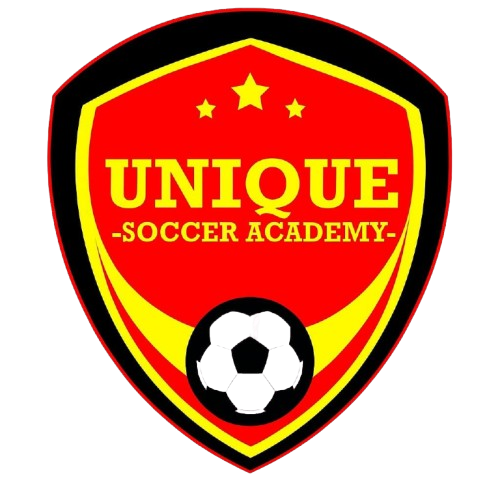

<div align="center">



# Royal Unique FC

### *Where Champions Are Made*

The official website of **Royal Unique FC** (formerly Unique Soccer Academy), a third-division football club in
**Kasoa-Apra, Gomoa East, Central Region, Ghana**.

[**🌐 Live Site**](https://isaaccodes01.github.io/unique-soccer-academy/) ·
[Facebook](https://facebook.com/profile.php?id=61565360907088) ·
[WhatsApp](https://wa.me/233544400543) ·
[Email](mailto:uniquesocceracademy1@gmail.com)


</div>

---

## 📸 Preview

| Before (2025, first-year project) | After (2026 redesign) |
|---|---|
|  |  |

---

## ⚽ About the Club

Royal Unique FC (then called Unique Soccer Academy) was founded on **20th March 2020** by **Mr. Nii Perrygrino Otoo** in Anyaa,
Greater Accra, with just 12 players training at Anyaa M/A School. The academy later moved to
Auntie-Aku's Kokompe Park, and on **11th February 2024** it moved to its current home in **Apra**.
Mr. Otoo now leads the academy alongside **Mr. Emmanuel Opare Asamoah**, CEO of
**Opas Construction**, the club's major sponsor.

**Mission:** To nurture football talent while creating pathways for our players to reach
professional clubs, academies and scholarship opportunities, locally and internationally.

**Vision:** To become a globally respected institution that transforms promising young
footballers into professional athletes and well-rounded individuals.

---

## ✨ Features

### Design and experience
- [ ] Modern brand design based on the club crest (black, gold and red), with Oswald + Inter fonts
- [ ] Sticky header that turns from transparent to solid on scroll, with a scroll-progress bar
- [ ] Animated hamburger menu with a slide-in mobile navigation (keyboard and screen-reader friendly)
- [ ] Full-screen hero with a Ken Burns background, animated headline and call-to-action buttons
- [ ] Scroll-reveal animations, count-up stats, hover micro-interactions and page transitions
- [ ] Fully responsive from 360px phones to large desktops
- [ ] Respects the user's *reduced motion* setting

### Pages
- [ ] **Home**: hero, stats, mission & vision, what we offer, latest news, gallery preview, sponsors
- [ ] **About**: club story, interactive timeline, leadership, training schedule, who can join
- [ ] **Team**: coaches and players with position filters
- [ ] **News**: news & announcements, next-match countdown, fixtures and results
- [ ] **Gallery**: photo grid with a swipeable lightbox, plus a video player modal
- [ ] **Contact**: contact cards, *Join the Academy* form (sends via WhatsApp), maps, FAQ
- [ ] **404**: a friendly "Offside!" page

### Under the hood
- [ ] Header and footer written once in `js/layout.js` and shared by every page
- [ ] Content (news, fixtures, players, photos) lives in `js/data.js`, so updates need no HTML
- [ ] Optimised WebP images, lazy loading and a fast Lighthouse score
- [ ] SEO meta tags, Open Graph share previews, sitemap and structured data

---

## 🗂️ Project Structure

```
unique-soccer-academy/
├── index.html          # Home
├── about.html          # Story, timeline, leadership, schedule
├── team.html           # Coaches and players
├── news.html           # News, announcements, fixtures & results
├── gallery.html        # Photos and videos
├── contact.html        # Contact, join form, maps, FAQ
├── 404.html            # Page not found
├── css/
│   └── style.css       # All styles (tokens → base → components → pages → animations)
├── js/
│   ├── layout.js       # Shared header + footer
│   ├── main.js         # Menu, scroll effects, animations
│   ├── data.js         # ✏️ Editable site content
│   ├── gallery.js      # Gallery tabs and lightbox
│   ├── news.js         # News page: ticker, filters, countdown, results
│   ├── team.js         # Team page: cards, position filter, 3D tilt
│   └── contact.js      # Join form → WhatsApp
├── assets/
│   ├── images/
│   └── videos/
├── docs/screenshots/   # Before/after screenshots
├── CLAUDE.md           # Rules for Claude Code
└── REDESIGN_PHASES.md  # Step-by-step redesign plan
```

---

## 🚀 Run It Locally

1. Clone the repo:
   ```bash
   git clone https://github.com/IsaacCodes01/unique-soccer-academy.git
   cd unique-soccer-academy
   ```
2. Open the folder in **VS Code**.
3. Install the **Live Server** extension, right-click `index.html`, and choose **Open with Live Server**.

No installs or build step needed. It's plain HTML, CSS and JavaScript.

---

## ✏️ Updating the Content

All changing content lives in **`js/data.js`**. To add a news post, a fixture, a result or a
player, copy an example object, fill it in, save, and refresh the page.

```js
news: [
  {
    date: "2026-11-15",
    title: "Pre-season training camp begins",
    summary: "Players report to Apra for the start of camp.",
    image: "assets/images/news/camp.webp",
    category: "News"            // or "Announcement"
  }
],
```

### Gallery photos and videos

Photos and videos are listed in `PHOTOS` and `VIDEOS` in `js/data.js`. To add a photo, put the
file in `assets/images/` and add one line with its `src`, `alt` (what the photo shows), `category`,
`width` and `height`.

### Video posters

Until a video has a `poster`, its card shows the video's own first frame. To make real poster
images, install [ffmpeg](https://ffmpeg.org/download.html) and run this from the project folder
(Git Bash):

```bash
mkdir -p assets/videos/posters
for v in assets/videos/*.mp4; do
  ffmpeg -y -ss 0.5 -i "$v" -frames:v 1 -q:v 3 "assets/videos/posters/$(basename "${v%.mp4}").jpg"
done
```

`-ss 0.5` takes the frame at half a second (the very first frame is often black), `-frames:v 1`
saves one frame, and `-q:v 3` is the JPEG quality (2 = best, 31 = worst). Then set each video's
poster in `js/data.js`, e.g. `poster: "assets/videos/posters/Unique_vids_1.jpg"`.

### Optimising images

Every `.jpg`/`.png` in `assets/images/` has a smaller `.webp` copy next to it, and each gallery
photo also has a 600px-wide `-thumb.webp` for the grids. The pages load the WebP and keep the
original as a fallback (`<picture>`).

**This happens automatically.** When you push a new or changed `.jpg`/`.png`, the GitHub Action
in `.github/workflows/optimize-images.yml` makes the WebP copies, commits them and republishes
the site (watch it in the repository's **Actions** tab). Afterwards run `git pull` so your
computer has the new files too.

To make them on your own computer instead (for example to preview before pushing), run these
three commands from the project folder (they work in PowerShell and Git Bash; `npx` downloads the
tool for you, nothing is added to the project):

```bash
# 1. Photos: WebP, at most 1600 x 1080, quality 65
npx sharp-cli@5 -i "assets/images/Unique_*.jpg" -o assets/images/ -f webp -q 65 --effort 6 resize 1600 1080 --fit inside --withoutEnlargement

# 2. Small copies for the photo grids, 600px wide
npx sharp-cli@5 -i "assets/images/Unique_*.jpg" -o "assets/images/{name}-thumb.webp" -f webp -q 65 --effort 6 resize 600 --withoutEnlargement

# 3. Hero and logos: higher quality, at most 1600px wide
npx sharp-cli@5 -i assets/images/Pitch.png assets/images/Opas.png "assets/images/RYFC copy.png" -o assets/images/ -f webp -q 80 --effort 6 resize 1600 --withoutEnlargement
```

- `-i` is the input (in quotes, `*` matches every photo), `-o` the output folder or file name
  (`{name}` = the original name without `.jpg`), `-f webp` the format.
- `-q` is the quality (1 to 100): lower is smaller but blurrier. `--effort 6` makes the smallest file.
- `resize W H --fit inside` shrinks the image to fit in a W x H box without cropping or stretching;
  `--withoutEnlargement` never makes a small image bigger.
- A new photo with a different name (say `player-10.jpg`) needs the same commands with its own name
  after `-i`. Forgot? No problem: the page shows the original instead (see `js/boot.js`).

Targets: hero under 250KB, gallery photos under 150KB.

### Share preview and SEO

- `assets/images/share-image.jpg` (1200 x 630) is the picture WhatsApp and Facebook show when
  someone shares a link. Each page's `<head>` has the Open Graph (`og:`) and Twitter tags for it.
  Facebook keeps old previews for a while: paste a link into the
  [Sharing Debugger](https://developers.facebook.com/tools/debug/) and click *Scrape Again*.
- `sitemap.xml` lists every page. Add new pages to it, and send it to Google in
  [Search Console](https://search.google.com/search-console).
- `robots.txt` only counts at the root of a domain. On GitHub Pages the site lives in
  `/unique-soccer-academy/`, so search engines read `isaaccodes01.github.io/robots.txt` instead.
  The file is ready for when the club gets its own domain; until then, submit the sitemap in
  Search Console.

---

## 🌍 Deployment

The site is hosted on **GitHub Pages** from the `main` branch.
Any push to `main` updates the live site within a minute or two.

*Settings → Pages → Source: Deploy from a branch → `main` / root*

---

## 🎨 Brand Colours

| Colour | Hex | Use |
|---|---|---|
| ⬛ Black | `#0B0B0D` | Header, footer, dark sections |
| 🟨 Gold | `#F5C518` | Main accent and buttons |
| 🟥 Red | `#D62828` | Highlights and badges |
| ⬜ Off-white | `#F7F5EF` | Light sections |

---

## 🤝 Sponsorship

We welcome individuals, businesses and organisations who want to support young football talent,
through equipment, training support or visibility.
Reach us on [WhatsApp](https://wa.me/233544400543) or at
[uniquesocceracademy1@gmail.com](mailto:uniquesocceracademy1@gmail.com).

**Proudly sponsored by Opas Construction.**

---

## 👨🏾‍💻 Author

Built and maintained by **Isaac Otabil**, an IT student at Ghana Communications Technology University.

The first version was built in my first year as a mid-semester exam project (graded **A**).
The 2026 redesign was planned and built with the help of Claude Code.

---

<div align="center">

© Royal Unique FC · Kasoa-Apra, Ghana

</div>
